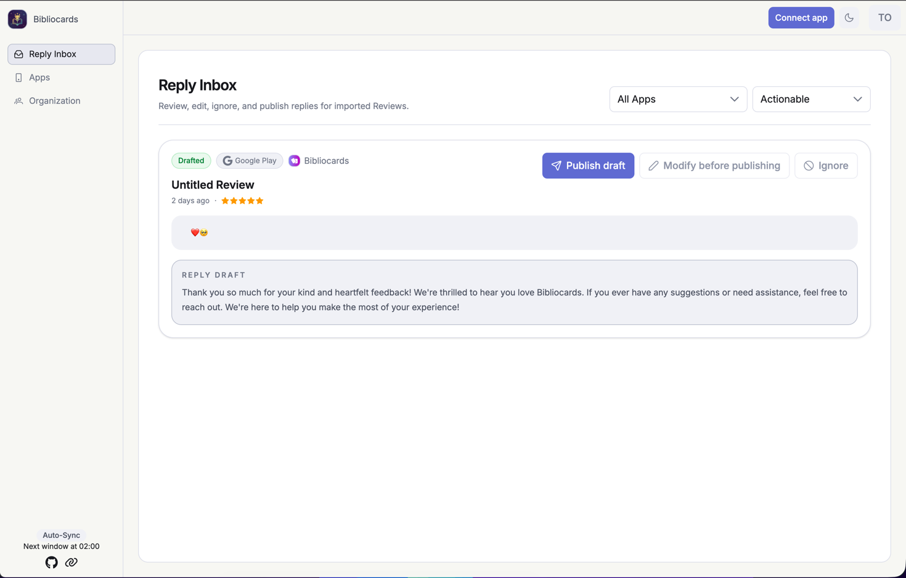

  

# ReviewInbox

An open-source Reply Inbox for App Store and Google Play Reviews. Import Reviews, prepare replies with AI, publish them yourself, and explore recurring product problems.

[Website](https://reviewinbox.app) · [User guides](https://reviewinbox.app/docs/)

## Current product

- Multiple Apps and Store Connections per Organization, with encrypted Store Credentials.
- Initial and scheduled Review sync, plus manual sync where available.
- AI or manual Reply Drafts, editing, ignoring, explicit publication, and Audit History.
- Guided draft regeneration: optional writing preferences and instructions, preview before accepting into the editor, then explicit save or publication.
- Reviews edited after publication return to the Reply Inbox for a new reply.
- Review analysis with intents, reported severity, an App-specific topic catalogue, and human corrections.
- Organization membership, invitations, account recovery, and Cloud subscriptions and usage limits.
- English and French interfaces, with light and dark themes.

The app is in early alpha. Weekly Digests, Google Play CSV import, and Organization-owned AI provider settings are not implemented.

## Self-hosting

Run the API, web app, worker, and Postgres with [Docker Compose](docker-compose.self-hosted.yml). Pin `REVIEWINBOX_VERSION` to a published release and follow the [self-hosting guide](apps/site/src/content/docs/docs/self-hosting.md) for installation, HTTPS, upgrades, and backups.

AI is optional. The app supports manual replies without it. The supplied Compose file passes the operator's AI settings to the API and worker; regeneration needs them on the API too.

## Documentation

| Need | Read |
| --- | --- |
| Set up development and run checks | [Contributing](CONTRIBUTING.md) |
| Understand boundaries and workflow rules | [Architecture](docs/architecture.md) |
| Understand past decisions and trade-offs | [ADRs](docs/adr/) |
| Use the product vocabulary | [Glossary](CONTEXT.md) |
| Change the interface | [Design](DESIGN.md) |
| Connect stores and work through Reviews | [User guides](apps/site/src/content/docs/docs/index.mdx) |
| Test Cloud billing locally | [Stripe setup](docs/stripe-local-billing.md) |
| Measure activation from stored records | [Acquisition report](docs/acquisition-measurement.md) |

Documentation describes the current implementation. ADRs and [HTML design references](docs/design/) remain in the repository; old plans, audits, and handoffs are available in Git history.

## License

[Apache-2.0](LICENSE.md).
